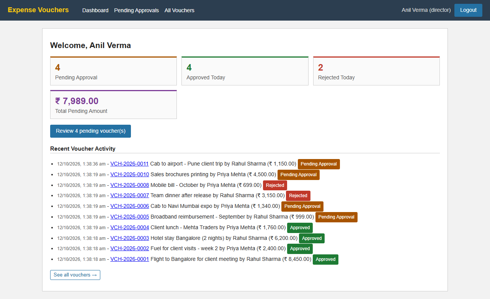
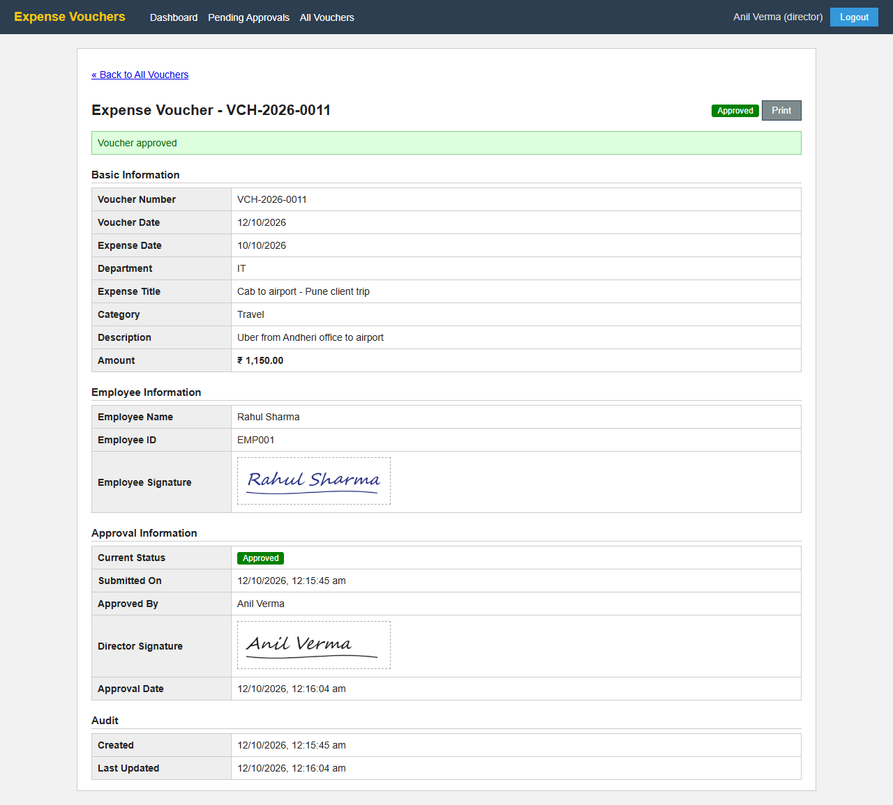

# 🧾 Expense Voucher Management System


Digital expense vouchers. **Employees** submit, the **Director** approves (with signature) or rejects (with reason), and **Accounts** tracks approved vouchers for reimbursement.

🌐 **Live demo: https://evms-ten.vercel.app**. The free server sleeps when idle, so the first login can take up to a minute.

[demo-walkthrough.webm](https://github.com/user-attachments/assets/69601f3b-6448-4b63-b461-a6b9f3578588)


📸 [Screenshots](docs/screenshots)

| Director dashboard | Approved voucher (both signatures) |
|---|---|
|  |  |

## 🔑 Demo Logins

The same accounts work on the live demo and on a local setup (`npm run db:setup`).

| Role | Name | Email | Password |
|---|---|---|---|
| Employee | Rahul Sharma (IT) | `employee@test.com` | `password123` |
| Employee | Priya Mehta (Sales) | `employee2@test.com` | `password123` |
| Director | Anil Verma | `director@test.com` | `password123` |
| Accounts | Sneha Joshi | `accounts@test.com` | `password123` |

The live demo has sample data: 9 users (5 more employees such as `arjun.nair@test.com`, same password), about 45 vouchers from the last two months in every status, and their history in MongoDB. Load the same data with `npm run db:seed-demo` (in `server/`).

Suggested walkthrough: log in as an **Employee** to create and submit a voucher, then as the **Director** to approve or reject it, then as **Accounts** to see the result.

## Features

- JWT login with role-based pages and APIs. The login page has one-click demo accounts and a show-password button
- **Draft → Pending → Approved / Rejected** flow with auto voucher numbers
- Signature upload for the employee (submit) and the Director (approve)
- Director can approve or reject straight from the Pending list (**View / Approve / Reject** on each row)
- Role dashboards, plus search, filter and sort on every list, and print
- Dashboard charts (amount by category, amount per week), **bulk approve** for the Director, pop-up notifications, and a **dark mode** switch in the user menu
- Navbar dropdown menus (Vouchers → Drafts / Pending / Approved / Rejected, and a user menu), a **My Profile** page to update the saved signature, an **Activity Log** page for the Director and Accounts, and **Export CSV** for Accounts
- **Two databases**: PostgreSQL holds users and vouchers; MongoDB holds the audit log (every login and voucher action), shown as a **History** table on each voucher and as the Director's recent activity

## Setup

Needs Node.js 18+ and PostgreSQL 14+. MongoDB is optional: without `MONGO_URL` the app works the same, only the audit log is off.

```bash
cd server && npm install
cp .env.example .env      # set DATABASE_URL, JWT_SECRET (and MONGO_URL)
npm run db:setup          # database + tables + demo users
npm run dev               # :5000

cd client && npm install
npm run dev               # :5173
```

Screenshots and the demo video are generated by `demo/demo.mjs` (Playwright). It resets the database, so run it against a local database only (instructions at the top of the file).

## Database Schema

PostgreSQL has three tables: **users** (role, department, saved signature), **vouchers** (all voucher, approval and audit fields) and **files** (signature images). A sequence generates unique voucher numbers. MongoDB has one collection, **audit_logs**: one document per action (who, what, when, which voucher, details).
→ [docs/DATABASE.md](docs/DATABASE.md)

## API

REST under `/api`: `auth/login`, `vouchers` (CRUD, `submit`, `approve`, `reject`, `history`, with search and filter query params), `dashboard` and `files/:id`. Every route except login uses a JWT and role checks.
→ [docs/API.md](docs/API.md)

## Assumptions

1. "Submitted" and "Pending Approval" are one status (`pending`).
2. Drafts are private. The Director and Accounts see only submitted vouchers.
3. Approved and rejected vouchers are final (no resubmit).
4. The last uploaded signature is saved and reused automatically.
5. Expense date can't be in the future. Currency is INR and "today" means IST.
6. Users come from the seed script (no sign-up page).

Deployment (Supabase + MongoDB Atlas + Render + Vercel): [docs/DEPLOYMENT.md](docs/DEPLOYMENT.md)

## License

Proprietary, all rights reserved. The code is shared only so it can be reviewed and evaluated as an assignment submission; reuse needs written permission. See [LICENSE](LICENSE).
