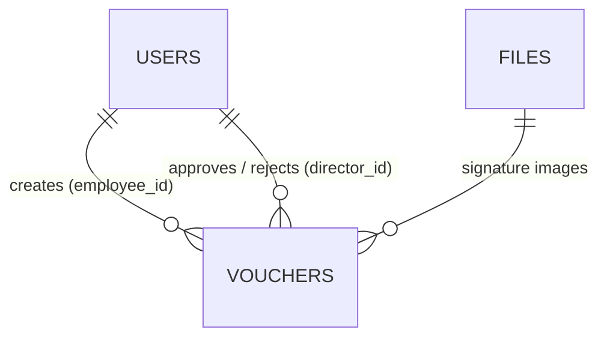

# Database Schema

PostgreSQL. Full SQL: [`server/db/schema.sql`](../server/db/schema.sql)

## users

| Column | Notes |
|---|---|
| `id` | serial PK |
| `name`, `email` | email is unique, used to log in |
| `password_hash` | bcrypt, never returned by the API |
| `role` | `employee`, `director` or `accounts` (CHECK) |
| `employee_code` | optional Employee ID |
| `department` | pre-filled in the voucher form |
| `signature_path` | last uploaded signature, reused next time |

## vouchers

| Group | Columns |
|---|---|
| Basic | `voucher_no` (unique, `VCH-2026-0001`), `voucher_date`, `expense_date`, `department`, `title`, `category`, `description`, `amount` (`NUMERIC(12,2)`, CHECK > 0) |
| Employee | `employee_id` → users, `employee_signature` |
| Approval | `status` (`draft / pending / approved / rejected`, CHECK), `director_id` → users, `director_signature`, `approved_at`, `rejected_at`, `rejection_reason` |
| Audit | `submitted_at`, `created_at`, `updated_at` |

Indexes are on `employee_id` and `status`.

## files

| Column | Notes |
|---|---|
| `id` | UUID PK (random, so image URLs can't be guessed) |
| `mime` | `image/png` or `image/jpeg` |
| `data` | image bytes (`BYTEA`, max 2 MB) |

Signatures are stored in the database rather than on disk, so they survive server restarts on hosting platforms where the disk gets wiped.

## Other

- **`voucher_no_seq`**: the sequence behind voucher numbers. Two vouchers saved at once can't get the same number, and a number is never reused after a draft is deleted.
- **Timezone**: timestamps are `TIMESTAMPTZ`, and the database timezone is `Asia/Kolkata`, so "today" on the dashboard follows IST.
- **Supabase**: Row Level Security is enabled with no policies. That blocks Supabase's public Data API, while the backend (which connects as `postgres`) is unaffected.
