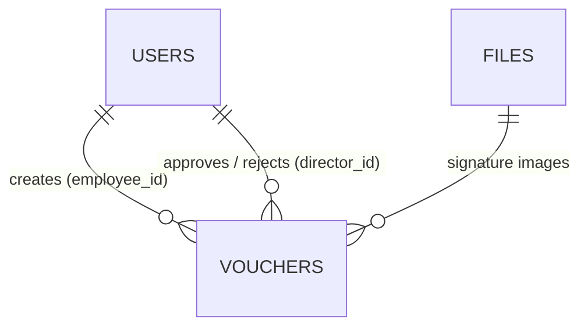

# Database Schema

PostgreSQL. Full SQL: [`server/db/schema.sql`](../server/db/schema.sql)



## users

| Column | Notes |
|---|---|
| `id` | serial PK |
| `name`, `email` | email is unique, used to log in |
| `password_hash` | bcrypt, never returned by the API |
| `role` | `employee`, `director` or `accounts` (CHECK) |
| `employee_code` | optional Employee ID |
| `department` | pre-filled in the voucher form |
| `signature_path` | last uploaded signature, reused next time |

## vouchers

| Group | Columns |
|---|---|
| Basic | `voucher_no` (unique, `VCH-2026-0001`), `voucher_date`, `expense_date`, `department`, `title`, `category`, `description`, `amount` (`NUMERIC(12,2)`, CHECK > 0) |
| Employee | `employee_id` → users, `employee_signature` |
| Approval | `status` (`draft / pending / approved / rejected`, CHECK), `director_id` → users, `director_signature`, `approved_at`, `rejected_at`, `rejection_reason` |
| Audit | `submitted_at`, `created_at`, `updated_at` |

Indexes are on `employee_id` and `status`.

## files

| Column | Notes |
|---|---|
| `id` | UUID PK (random, so image URLs can't be guessed) |
| `mime` | `image/png` or `image/jpeg` |
| `data` | image bytes (`BYTEA`, max 2 MB) |

Signatures are stored in the database rather than on disk, so they survive server restarts on hosting platforms where the disk gets wiped.

## Other

- **`voucher_no_seq`**: the sequence behind voucher numbers. Two vouchers saved at once can't get the same number, and a number is never reused after a draft is deleted.
- **Timezone**: timestamps are `TIMESTAMPTZ`, and the database timezone is `Asia/Kolkata`, so "today" on the dashboard follows IST.
- **Supabase**: Row Level Security is enabled with no policies. That blocks Supabase's public Data API, while the backend (which connects as `postgres`) is unaffected.

# MongoDB: audit log

The audit log lives in MongoDB (database `evms`, collection `audit_logs`, model [`server/src/models/AuditLog.js`](../server/src/models/AuditLog.js)). PostgreSQL stays the source of truth for users and vouchers; MongoDB only records *what happened*.

Why MongoDB for this: events are append-only, never updated or joined, and each action carries different extra data (`changed` fields for an edit, `reason` for a rejection). A schema-less document fits that better than a wide SQL table.

```json
{
  "action": "voucher_approved",
  "voucherId": 11,
  "voucherNo": "VCH-2026-0011",
  "user": { "id": 3, "name": "Anil Verma", "role": "director" },
  "details": { "amount": 1150 },
  "ip": "::1",
  "createdAt": "2026-10-27T10:15:00.000Z"
}
```

| Field | Notes |
|---|---|
| `action` | `login`, `login_failed`, `voucher_created`, `voucher_updated`, `voucher_deleted`, `voucher_submitted`, `voucher_approved`, `voucher_rejected` |
| `voucherId`, `voucherNo` | link to `vouchers` in PostgreSQL (empty for logins) |
| `user` | who did it (copied, so the event stays readable) |
| `details` | `{ amount }`, `{ changed: [...] }` for edits, `{ reason }` for rejections, `{ email }` for failed logins. Passwords are never logged |
| `ip` | request IP (not returned by the API) |

Indexes: `{ voucherId: 1, createdAt: 1 }` for one voucher's history, `{ createdAt: -1 }` for latest activity.

- Writes are fire-and-forget: a request never waits for or fails because of the audit log.
- MongoDB is optional. Without `MONGO_URL` (or if it is down) everything works and the History section says the log is not available.
- `npm run db:seed-demo` fills both databases with the same sample timeline: users and vouchers in PostgreSQL, and the matching logins and voucher events (with their original dates) in MongoDB.
- `npm run db:setup` also empties `audit_logs` (only for a local MongoDB). `npm run db:backfill-audit` creates events for vouchers that existed before the log, from the PostgreSQL timestamps.
